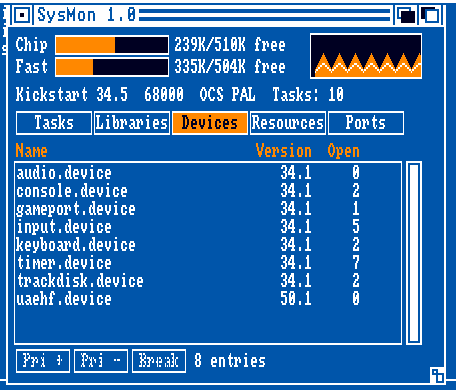
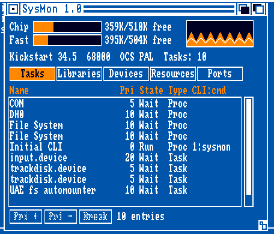
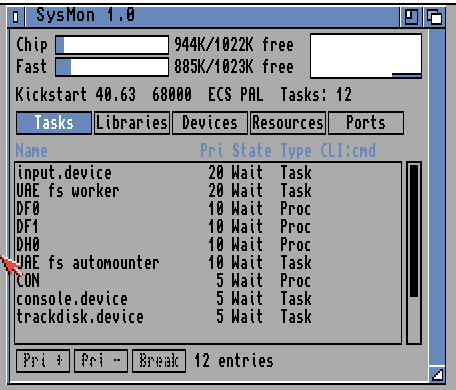
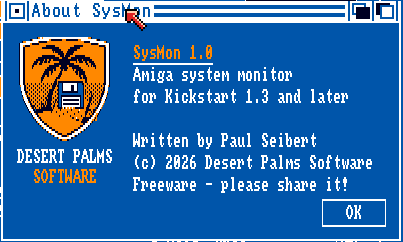
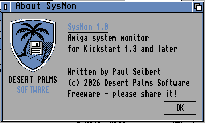

<p align="center">
  
</p>

<h1 align="center">SysMon</h1>

<p align="center">
  <b>A live system monitor for the classic Amiga, Kickstart 1.3 and up.</b><br>
  Freeware by Paul Seibert &middot; &copy; 2026 Desert Palms Software
</p>

<p align="center">
  
</p>

<p align="center">
  <a href="https://github.com/PaulSeibert/amiga-sysmon/releases/latest"><b>Download SysMon 1.0</b></a> &middot;
  <a href="docs/media/sysmon-preview.mp4">Preview video (MP4)</a> &middot;
  <a href="SysMon.readme">Aminet readme</a>
</p>

---

SysMon is a small Workbench tool that shows you what your Amiga is doing, live, in one
window: how much memory is free, which tasks are running and what they are waiting for,
which libraries and devices are open, and what hardware you have. It is written in C
against the **AmigaOS 1.3** includes, so it runs on a stock A500 or A2000. It also runs
unchanged on AmigaOS 2.x and 3.x.

It is a real utility, not a demo. It is 22 KB of 68000 code, needs no libraries beyond the
ROM, and sleeps between updates so it costs almost no CPU time. It is careful never to
destabilise the system it is watching.

## Contents

- [Features](#features)
- [Screenshots](#screenshots)
- [Download and install](#download-and-install)
- [Using SysMon](#using-sysmon)
- [How it works](#how-it-works)
- [Building from source](#building-from-source)
- [Testing](#testing)
- [Repository layout](#repository-layout)
- [Credits and license](#credits-and-license)

## Features

**At a glance**

- **Chip RAM and Fast RAM gauges**: free and total memory, updated live.
- **Rolling memory graph**: chip memory use in colour, fast memory as a dotted line.
- **Hardware line**: Kickstart version, CPU and FPU, chipset (OCS / ECS / AGA),
  PAL or NTSC, and the number of running tasks.

**Five views of the system**, switched with the tabs or the *View* menu:

| View | What you see |
|---|---|
| **Tasks** | Name, priority, state (Run / Ready / Wait), task or process, and for CLI processes the CLI number and the command that is running |
| **Libraries** | Name, version.revision, open count |
| **Devices** | Name, version.revision, open count |
| **Resources** | Name, plus version when the resource has a library header |
| **Ports** | Public message ports and the task each one signals |

Click a row, or use the cursor keys, to select it. The status line then shows its address,
and for a task the signals it is waiting for.

**Actions**

- **Pri + / Pri −**: change the selected task's priority one step at a time, within −20…+20.
- **Break**: send the selected task a Ctrl-C, after asking first. Most CLI commands stop when
  they get one. Try it on SysMon itself.
- **Save report**: writes a full plain-text system report to `RAM:SysMon.report`.
- **Options**: refresh every 1, 2 or 5 seconds; sort by name or by priority (remembered per view).

SysMon never kills or removes tasks. That is not safe on the Amiga, and a monitor should
not be able to crash the machine it is monitoring.

## Screenshots

| Workbench 1.3 | Workbench 3.1 |
|:---:|:---:|
|  |  |
|  |  |

SysMon draws with the Workbench's own four colours and never changes the palette, so it
fits in on both systems. The About window's logo has artwork for each palette: the orange
sunset on 1.3, a matching blue version on 2.0 and later.

> The animation at the top was recorded in WinUAE from a special demo build
> (`./testdisk.sh demo`). That build switches views and allocates and frees memory on its
> own so the gauges move without anyone at the mouse. The release build does none of this.

## Download and install

Get the latest release from the [Releases page](https://github.com/PaulSeibert/amiga-sysmon/releases/latest):

| File | What it is |
|---|---|
| `SysMon.lha` | The release archive: a `SysMon` drawer holding the program, its icon and the readme |
| `SysMon.readme` | The Aminet readme (also inside the archive) |
| `sysmon.adf` | A bootable floppy image that prints a report and opens SysMon, handy for emulators |

To install, unpack `SysMon.lha` with LhA (on the Amiga) or any LHA tool (on a PC) and copy
the `SysMon` drawer anywhere you like, for example `SYS:Utilities`. SysMon needs no
libraries, fonts or assigns.

**Requirements:** any Amiga with Kickstart 1.3 or later and a 68000 or better CPU. 512 KB
of memory is plenty. It was tested on Kickstart 1.3 (A500, OCS, 512 KB chip + 512 KB) and
Kickstart 3.1 (ECS, 1 MB chip + 1 MB fast).

## Using SysMon

**From Workbench:** double-click the SysMon icon. The window can be dragged, sent to the
back and made taller to show more rows.

**From the CLI:**

```
sysmon                         open the window
sysmon REPORT                  print the text report to the CLI and exit
sysmon >RAM:sys.txt REPORT     the same, into a file (on 1.3 the > must come first)
```

`REPORT` mode is handy in scripts, or for sending someone your system configuration when you
ask for help. It looks like this (Kickstart 1.3 on an A500):

```
SysMon 1.0 system report
Written by Paul Seibert, (c) 2026 Desert Palms Software. Freeware.

Kickstart 34.5  Exec 34.2  CPU 68000  FPU none  Chipset OCS  PAL
Chip RAM     429K free of    510K, largest block    428K  (439344 bytes free)
Fast RAM     424K free of    504K, largest block    423K  (434504 bytes free)

Tasks (pri, state, type, name): 10
    20  Wait   Task input.device
    10  Wait   Proc DH0
     5  Wait   Task trackdisk.device
     0  Run    Proc Initial CLI              CLI 1 sysmon
  ...
Libraries: 9
  dos.library                   34.3    open 3
  exec.library                  34.2    open 2
  ...
```

**Keyboard shortcuts** (Right Amiga + key):

| Key | Action | Key | Action |
|---|---|---|---|
| A | About | T | Tasks view |
| S | Save report | L | Libraries view |
| Q | Quit | D | Devices view |
| | | R / P | Resources / Ports view |

The cursor keys ↑ and ↓ (without Amiga) move the selection. On an emulator such as WinUAE, Right Amiga is usually mapped to the Right Windows key, or
to Right Ctrl if you enable that option.

## How it works

SysMon reads Exec's own data structures directly: `SysBase->TaskReady` and `TaskWait`,
`LibList`, `DeviceList`, `ResourceList`, `PortList` and `MemList`. The rest is careful
handling of shared system state on a machine with no memory protection.

- **Short, safe snapshots.** The task lists are changed by interrupts (a `Signal()` moves a
  task from waiting to ready), so SysMon copies them with `Disable()` held. The other lists
  are copied under `Forbid()`. While a list is held, SysMon only copies bytes into a fixed
  buffer. It never draws, allocates or calls anything that could wait, and it draws only
  after releasing the list.
- **Actions re-check first.** A task you selected a second ago may have exited. Before
  *Pri ±* or *Break*, SysMon stops multitasking, confirms that the task is still in the
  system lists with the same name, and only then acts.
- **Hardware detection without guesswork.** The Kickstart version comes from the ROM header.
  CPU and FPU come from `AttnFlags`. The chipset comes from the Agnus/Alice ID in `VPOSR`
  (a read-only register), and PAL/NTSC from `graphics.library`.
- **Hand-built 1.3 interface.** Kickstart 1.3 has no GadTools, so the tabs, buttons and
  list are drawn by SysMon over plain Intuition gadgets, with a real proportional scroller.
  Disabled buttons get the classic ghosted pattern. Area patterns are read by the blitter,
  so they live in chip RAM.
- **Event-driven.** Refreshes come from `timer.device` (`UNIT_VBLANK`). The main loop sits in
  `Wait()` on the timer, the window and Ctrl-C, so SysMon uses no CPU time between updates.
- **1.3 only, by construction.** It is compiled against the Kickstart 1.3 (V33) includes, so
  any call to a newer function fails at build time instead of crashing an A500.

Source files:

| File | Purpose |
|---|---|
| [`src/main.c`](src/main.c) | Startup, CLI vs Workbench, timer, event loop |
| [`src/sysinfo.c`](src/sysinfo.c) | Memory, hardware and system-list snapshots; safe task actions |
| [`src/ui.c`](src/ui.c) | The window: gauges, graph, tabs, list, scroller, menus, actions |
| [`src/about.c`](src/about.c) | The About window with the Desert Palms Software shield |
| [`src/report.c`](src/report.c) | The text report (CLI `REPORT` and *Save report*) |

## Building from source

SysMon is cross-compiled on a PC. You need:

- **Docker**, to run the [`amigadev/crosstools:m68k-amigaos`](https://hub.docker.com/r/amigadev/crosstools)
  image. It provides [bebbo's amiga-gcc](https://github.com/bebbo/amiga-gcc) (GCC 6.5 for
  m68k-amigaos), `xdftool` from [amitools](https://github.com/cnvogelg/amitools), and `lha`.
- **Python 3**, for the small tools that turn the ASCII art in `art/` into icons and image data.

Then:

```sh
./build.sh       # build/sysmon, build/sysmon.info, build/sysmon.adf (bootable test disk)
./release.sh     # dist/SysMon.lha, dist/SysMon.readme, dist/sysmon.adf
```

The compiler is run with `-mcrt=nix13 -m68000`: libnix startup code for Kickstart 1.3,
plain 68000 code, and the 1.3 includes.

The icons and the logo are plain text files you can edit. Each character is one pixel in one
of the four Workbench 1.3 colours (`.` blue, `W` white, `K` black, `O` orange):

- [`tools/mkicon.py`](tools/mkicon.py) writes Workbench 1.x `.info` files (tool, drawer and
  project icons).
- [`tools/mkimage.py`](tools/mkimage.py) turns art into Intuition `Image` plane data, with
  separate pen maps for the 1.3 and 2.0+ palettes.

## Testing

No Kickstart ROMs or Workbench disks are included. To test, use your own, for example with
[WinUAE](https://www.winuae.net/) or [FS-UAE](https://fs-uae.net/).

- **Boot test:** boot `build/sysmon.adf` with a host folder mounted as a hard disk called
  `Work:`. The disk writes `Work:sysmon-report.txt` and opens the window, so you can check
  the results from the PC without touching the mouse.
- **Memory-leak test:** `./leaktest.sh` builds `build/leaktest.adf`. Set `WB13_ADF` to your
  own Workbench 1.3 disk image, which provides `Run`, `Wait` and `Break`. The test disk runs
  SysMon twice, quits it each time with Ctrl-C, and writes a report before, between and after
  the runs. The free-memory byte counts must match exactly, and on Kickstart 1.3 they do.
- **Screenshot builds:** `./testdisk.sh about` opens the About window at start;
  `./testdisk.sh demo` is the self-driving build used for the animation.

## Repository layout

```
src/            C sources
art/            icon and logo artwork as ASCII (one character per pixel)
tools/          mkicon.py, mkimage.py (art -> .info / C), dumpinfo.sh (inspect reference icons)
docs/media/     screenshots, animation and preview video
SysMon.readme   Aminet readme (shipped in the archive)
build.sh        build the program, icon and test disk
release.sh      build the LHA release archive
leaktest.sh     memory-leak test disk (needs your Workbench 1.3 ADF)
testdisk.sh     About / demo screenshot builds
```

## Credits and license

**SysMon** was written by **Paul Seibert**, © 2026 **Desert Palms Software**.

SysMon is **freeware**. See [LICENSE](LICENSE) for the terms. In short: free to use and to
copy unchanged, including on Aminet, cover disks and collections; no warranty.

Built with [bebbo's amiga-gcc](https://github.com/bebbo/amiga-gcc) and libnix,
[amitools](https://github.com/cnvogelg/amitools), and tested in [WinUAE](https://www.winuae.net/).
Amiga is a trademark of its respective owner.

<p align="center">
  <br>
  <b>Desert Palms Software</b>: new software for classic Amiga computers.
</p>
